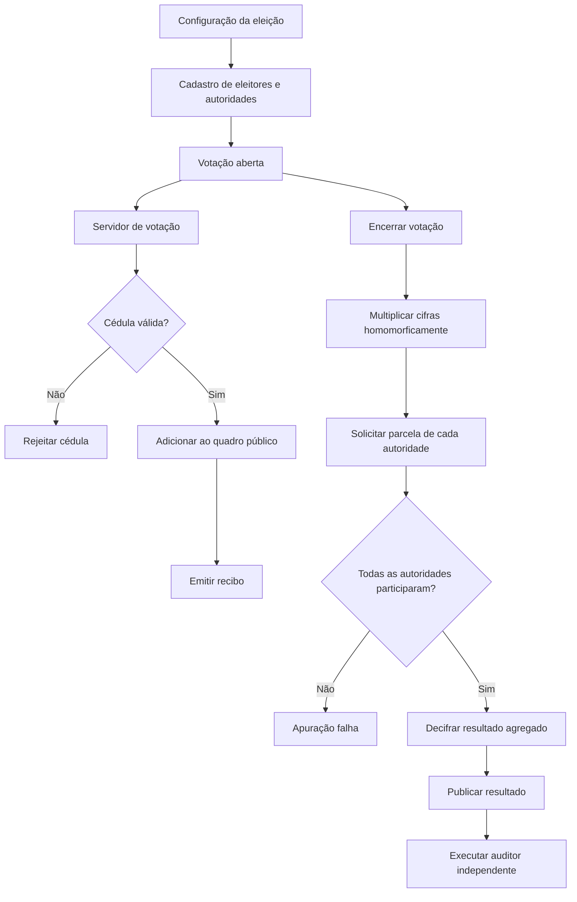
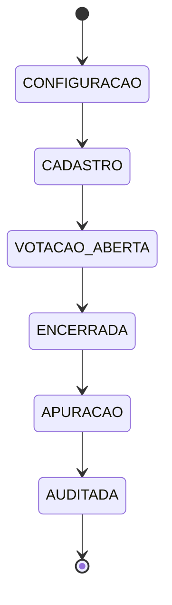
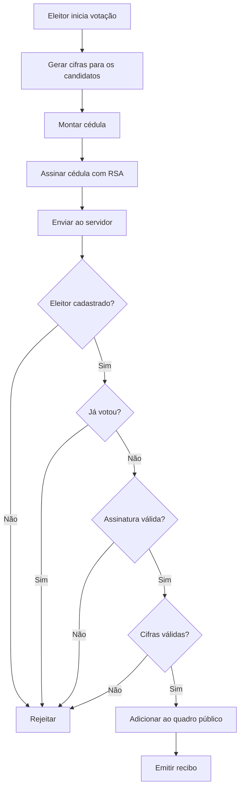
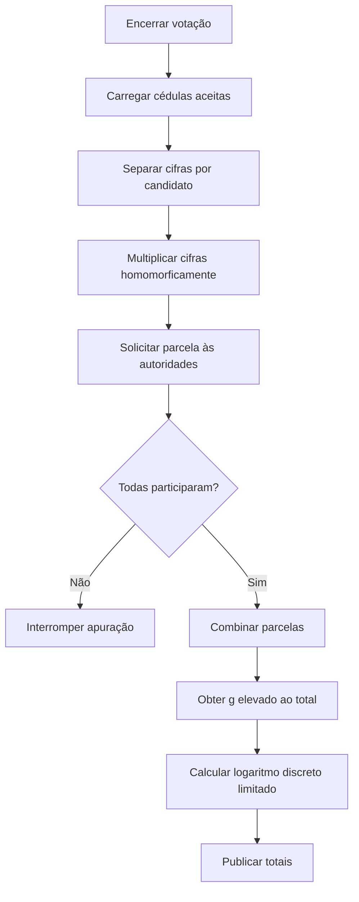
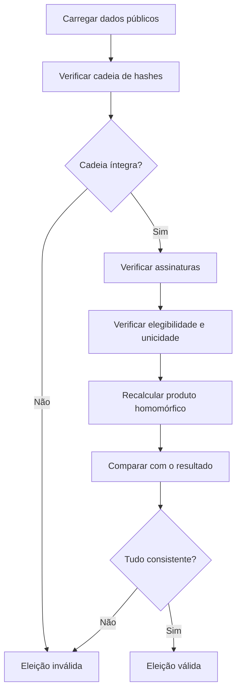

# URNA_ONLINE

Sistema de votação eletrônica seguro desenvolvido para a disciplina de Segurança Computacional.

O projeto aplica ElGamal exponencial, Diffie-Hellman, RSA, assinaturas digitais e funções hash para implementar uma eleição completa, incluindo cadastro, votação, encerramento, apuração e auditoria.

> **Atenção:** este projeto possui finalidade acadêmica. Não deve ser utilizado para eleições reais.

## Participantes

- Carlos Victor Albuquerque Oliveira: 232009558
- Eduardo Luna Scalassara: 232011289
- Leandro Coelho da Silva: 232011396
- Pedro Afonso Custodio De Lima: 232011350

## Arquitetura

A solução utiliza uma **arquitetura monolítica modular com auditor independente e autoridades distribuídas**.

O sistema é organizado em módulos bem definidos, executados por uma interface de linha de comando. O servidor de votação concentra o controle do ciclo eleitoral, mas não possui a chave privada completa da eleição. As autoridades mantêm suas próprias chaves privadas e participam conjuntamente da apuração.

O auditor é executado separadamente e utiliza apenas os dados públicos da eleição. Ele não deve acessar o estado interno do servidor nem as chaves privadas das autoridades.

### Visão geral



### Entidades do sistema

| Entidade | Responsabilidade |
|---|---|
| Eleitor | Possui uma chave RSA, cria a cédula, cifra os votos e assina a cédula |
| Servidor de votação | Controla o fluxo, valida cédulas, verifica assinaturas e impede votos duplicados |
| Autoridade eleitoral | Gera uma parcela da chave privada e participa da decifração do resultado |
| Quadro público | Armazena as cédulas aceitas em uma cadeia de hashes somente de acréscimo |
| Auditor | Verifica a eleição usando somente os dados públicos |
| Administrador | Configura a eleição, sem conhecer a chave privada completa |

## Fluxo da eleição

A eleição deve seguir os estados abaixo, sem permitir retrocessos:



1. **Configuração:** criação da eleição, candidatos e parâmetros criptográficos.
2. **Cadastro:** registro dos eleitores, suas chaves públicas e das autoridades.
3. **Votação aberta:** recebimento e validação das cédulas.
4. **Encerramento:** bloqueio de novos votos.
5. **Apuração:** agregação homomórfica e participação das autoridades.
6. **Auditoria:** verificação independente dos dados públicos.

## Organização das pastas

A estrutura planejada é:

```text
URNA_ONLINE/
├── src/
│   ├── crypto/
│   │   ├── group.py
│   │   ├── elgamal.py
│   │   ├── homomorphic.py
│   │   └── signatures.py
│   ├── election/
│   │   ├── election.py
│   │   ├── candidates.py
│   │   └── states.py
│   ├── server/
│   │   ├── registration.py
│   │   ├── voting.py
│   │   ├── validation.py
│   │   └── tally.py
│   ├── authorities/
│   │   ├── authority.py
│   │   └── partial_decryption.py
│   ├── bulletin_board/
│   │   ├── board.py
│   │   └── hash_chain.py
│   ├── auditor/
│   │   └── auditor.py
│   └── cli/
│       └── main.py
├── data/
│   ├── public/
│   │   ├── election.json
│   │   ├── voters.json
│   │   ├── bulletin_board.jsonl
│   │   ├── aggregate_ciphertexts.json
│   │   ├── authority_partials.json
│   │   └── result.json
│   └── private/
│       ├── authority_1.key
│       ├── authority_2.key
│       └── authority_3.key
├── tests/
├── requirements.txt
├── README.md
└── demo.py
```

A pasta `data/private/` não deve ser versionada. Ela deve ser adicionada ao `.gitignore`.

## Como cada módulo funciona

### Módulo `crypto`

Responsável pelas primitivas criptográficas:

- parâmetros do grupo modular;
- exponenciação e inverso modular;
- ElGamal exponencial;
- multiplicação homomórfica;
- assinaturas RSA;
- funções hash.

A cifra de um voto é:

```text
(c1, c2) = (g^r, g^m · h^r mod p)
```

onde `m` deve representar `0` ou `1`.

### Módulo `authorities`

Cada autoridade gera uma chave privada própria `x_i` e uma chave pública:

```text
h_i = g^x_i
```

A chave pública conjunta é:

```text
h = h_1 · h_2 · ... · h_n mod p
```

Nenhuma autoridade isolada nem o servidor deve conhecer a chave privada completa.

### Módulo `server`

O servidor deve:

- controlar os estados da eleição;
- cadastrar eleitores e autoridades;
- verificar elegibilidade;
- verificar assinaturas;
- impedir voto duplicado;
- publicar cédulas aceitas;
- emitir recibos;
- impedir resultados antes do encerramento.

### Módulo `bulletin_board`

O quadro público deve ser somente de acréscimo. Cada registro deve conter:

- índice;
- identificador do eleitor;
- cifras por candidato;
- assinatura do eleitor;
- hash do registro anterior;
- hash do registro atual.

O hash deve ser calculado sobre uma representação canônica do registro. Evitem incluir timestamps desnecessários.

### Módulo `auditor`

O auditor deve receber somente os arquivos públicos e verificar:

- cadeia de hashes;
- assinaturas dos eleitores;
- elegibilidade;
- unicidade dos eleitores;
- produto homomórfico das cifras;
- participação das autoridades;
- consistência do resultado.

O auditor não deve importar o estado interno do servidor.

## Fluxo da votação



## Fluxo da apuração



## Fluxo da auditoria



## Como implementar

A implementação deve seguir esta ordem:

1. Implementar os parâmetros e operações do grupo modular.
2. Implementar ElGamal exponencial.
3. Implementar geração das chaves das autoridades.
4. Implementar cadastro de eleitores e autoridades.
5. Implementar assinaturas e validação das cédulas.
6. Implementar o controle de estados da eleição.
7. Implementar o quadro público encadeado por hashes.
8. Implementar recibos.
9. Implementar apuração homomórfica.
10. Implementar participação conjunta das autoridades.
11. Implementar o auditor independente.
12. Criar testes e o roteiro da demonstração.

Cada etapa deve possuir testes antes da integração com a etapa seguinte.

## Vantagens da arquitetura

- Separação clara de responsabilidades.
- Menor complexidade de implementação.
- Fácil execução por linha de comando.
- Facilita testes unitários.
- Permite demonstrar falhas específicas.
- O auditor pode ser executado sem acessar dados privados.
- As chaves privadas das autoridades ficam separadas.
- A arquitetura corresponde diretamente aos requisitos do enunciado.

## Desvantagens e limitações

- O servidor é um ponto central de disponibilidade.
- Se uma autoridade não participar, a apuração falha.
- Se todas as autoridades conspirarem, elas podem reconstruir a chave e tentar decifrar votos individuais.
- O quadro público local não possui replicação automática.
- Sem uma prova criptográfica de que cada cifra representa 0 ou 1, um eleitor malicioso pode tentar cifrar outro valor.
- A solução não substitui um sistema eleitoral real.
- O uso de arquivos locais não oferece a mesma disponibilidade de uma infraestrutura distribuída.
- Um administrador pode tentar impedir o funcionamento do servidor, embora alterações publicadas possam ser detectadas pelo auditor.

## Testes

Os testes devem cobrir:

- cifragem e decifração;
- soma homomórfica;
- geração das chaves;
- assinatura válida e inválida;
- eleitor não cadastrado;
- voto duplicado;
- cédula adulterada;
- registro removido ou reordenado;
- apuração sem autoridade;
- auditoria de eleição válida;
- auditoria de eleição adulterada;
- cifra com valor diferente de 0 ou 1.

O comando de execução dos testes será documentado quando a ferramenta de testes for definida.

## Demonstração

A demonstração deve conter:

1. Eleição com dois candidatos.
2. Pelo menos três eleitores.
3. Pelo menos três autoridades.
4. Votos válidos.
5. Tentativa de voto duplicado.
6. Encerramento da eleição.
7. Tentativa de apuração sem uma autoridade.
8. Apuração com todas as autoridades.
9. Adulteração de uma cédula.
10. Detecção da adulteração pelo auditor.

## Segurança e credenciais

Nunca versionar:

- chaves privadas;
- senhas;
- tokens;
- dados reais de eleitores;
- arquivos da pasta `data/private/`.

O arquivo `.gitignore` deve conter pelo menos:

```text
data/private/
*.key
*.pem
.env
__pycache__/
.pytest_cache/
```

## Observação acadêmica

O código e o relatório devem ser compreendidos por todos os integrantes. Cada pessoa deve conseguir explicar as decisões criptográficas, o fluxo da eleição, as limitações e os testes realizados.


## Implementação atual da Pessoa 1

A base criptográfica já está organizada em submódulos Python:

- `src/crypto/group/`: parâmetros RFC 3526, validações do grupo e operações modulares.
- `src/crypto/elgamal/`: cifragem ElGamal exponencial para votos 0/1 e busca discreta limitada.
- `src/crypto/homomorphic/`: agregação de cifras e combinação das parcelas de apuração.
- `src/crypto/bit_proof/`: prova OR de Chaum-Pedersen com Fiat-Shamir para demonstrar que a cifra representa 0 ou 1.
- `data/public/crypto_params.json`: cópia pública dos parâmetros criptográficos.
- `tests/crypto/`: testes unitários dos módulos.

Cada submódulo possui um `README.md` próprio com entradas, saídas, fluxo e cuidados de segurança.

Para preparar o ambiente e executar os testes:

```bash
python -m pip install -r requirements.txt
python -m pytest -q
```

Os testes usam um grupo pequeno apenas para serem rápidos. O código da aplicação usa o grupo RFC 3526 de 2048 bits. Esta implementação cobre as tarefas T02, T03, T10 e T12 atribuídas à Pessoa 1 e ainda depende da integração com os módulos das outras pessoas do grupo.
