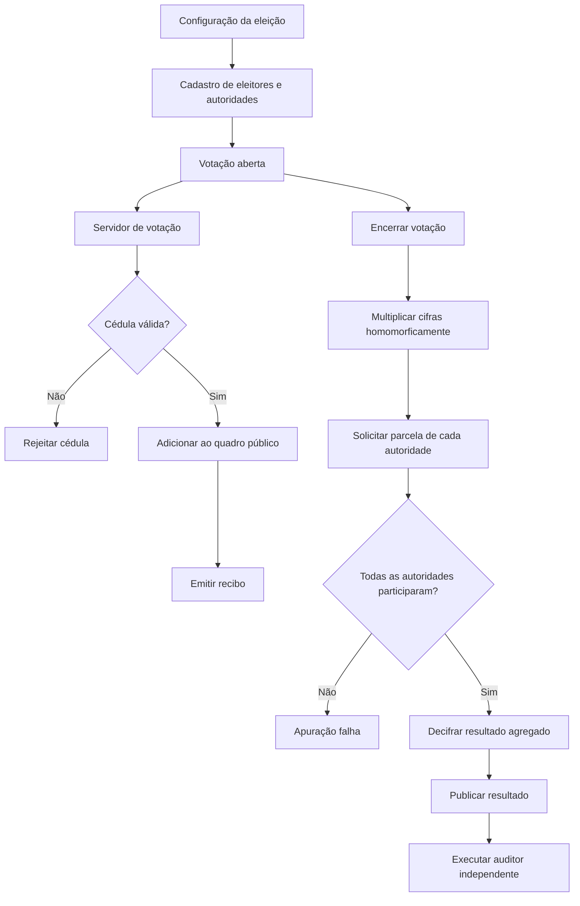
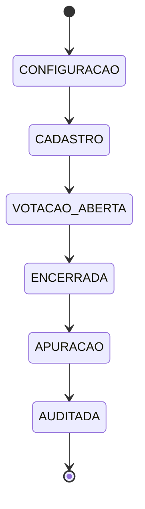
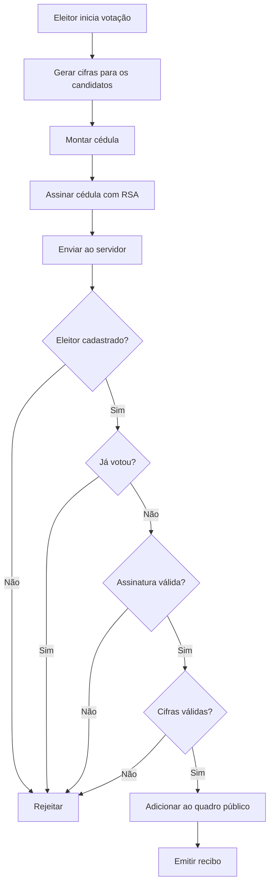
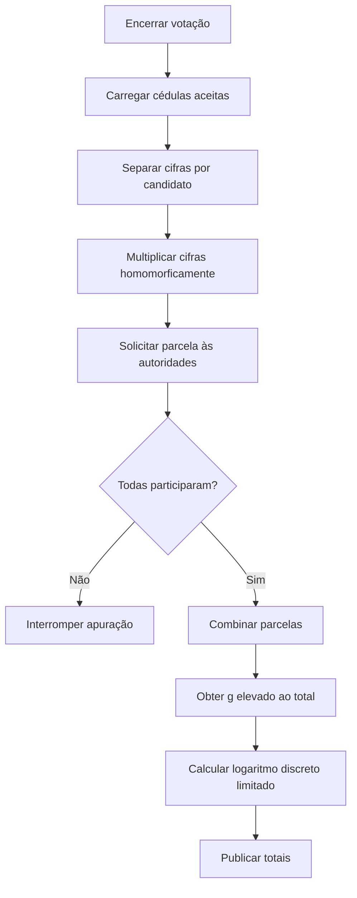
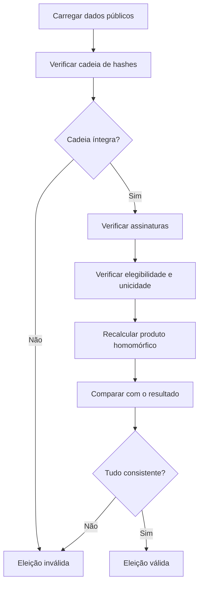

# URNA_ONLINE

Sistema de votação eletrônica seguro desenvolvido para a disciplina de Segurança Computacional.

O projeto aplica ElGamal exponencial, Diffie-Hellman, RSA, assinaturas digitais e funções hash para implementar uma eleição completa, incluindo cadastro, votação, encerramento, apuração e auditoria.

> **Atenção:** este projeto possui finalidade acadêmica. Não deve ser utilizado para eleições reais.

## Participantes

- Carlos Victor Albuquerque Oliveira: 232009558
- Eduardo Luna Scalassara: 232011289
- Leandro Coelho da Silva: 232011396
- Pedro Afonso Custodio De Lima: 232011350

## Arquitetura

A solução utiliza uma **arquitetura monolítica modular com auditor independente e autoridades distribuídas**.

O sistema é organizado em módulos bem definidos, executados por uma interface de linha de comando. O servidor de votação concentra o controle do ciclo eleitoral, mas não possui a chave privada completa da eleição. As autoridades mantêm suas próprias chaves privadas e participam conjuntamente da apuração.

O auditor é executado separadamente e utiliza apenas os dados públicos da eleição. Ele não deve acessar o estado interno do servidor nem as chaves privadas das autoridades.

### Visão geral



### Entidades do sistema

| Entidade | Responsabilidade |
|---|---|
| Eleitor | Possui uma chave RSA, cria a cédula, cifra os votos e assina a cédula |
| Servidor de votação | Controla o fluxo, valida cédulas, verifica assinaturas e impede votos duplicados |
| Autoridade eleitoral | Gera uma parcela da chave privada e participa da decifração do resultado |
| Quadro público | Armazena as cédulas aceitas em uma cadeia de hashes somente de acréscimo |
| Auditor | Verifica a eleição usando somente os dados públicos |
| Administrador | Configura a eleição, sem conhecer a chave privada completa |

## Fluxo da eleição

A eleição deve seguir os estados abaixo, sem permitir retrocessos:



1. **Configuração:** criação da eleição, candidatos e parâmetros criptográficos.
2. **Cadastro:** registro dos eleitores, suas chaves públicas e das autoridades.
3. **Votação aberta:** recebimento e validação das cédulas.
4. **Encerramento:** bloqueio de novos votos.
5. **Apuração:** agregação homomórfica e participação das autoridades.
6. **Auditoria:** verificação independente dos dados públicos.

## Organização das pastas

A estrutura planejada é:

```text
URNA_ONLINE/
├── src/
│   ├── crypto/
│   │   ├── group.py
│   │   ├── elgamal.py
│   │   ├── homomorphic.py
│   │   └── signatures.py
│   ├── election/
│   │   ├── election.py
│   │   ├── candidates.py
│   │   └── states.py
│   ├── server/
│   │   ├── registration.py
│   │   ├── voting.py
│   │   ├── validation.py
│   │   └── tally.py
│   ├── authorities/
│   │   ├── authority.py
│   │   └── partial_decryption.py
│   ├── bulletin_board/
│   │   ├── board.py
│   │   └── hash_chain.py
│   ├── auditor/
│   │   └── auditor.py
│   └── cli/
│       └── main.py
├── data/
│   ├── public/
│   │   ├── election.json
│   │   ├── voters.json
│   │   ├── bulletin_board.jsonl
│   │   ├── aggregate_ciphertexts.json
│   │   ├── authority_partials.json
│   │   └── result.json
│   └── private/
│       ├── authority_1.key
│       ├── authority_2.key
│       └── authority_3.key
├── tests/
├── requirements.txt
├── README.md
└── demo.py
```

A pasta `data/private/` não deve ser versionada. Ela deve ser adicionada ao `.gitignore`.

## Como cada módulo funciona

### Módulo `crypto`

Responsável pelas primitivas criptográficas:

- parâmetros do grupo modular;
- exponenciação e inverso modular;
- ElGamal exponencial;
- multiplicação homomórfica;
- assinaturas RSA;
- funções hash.

A cifra de um voto é:

```text
(c1, c2) = (g^r, g^m · h^r mod p)
```

onde `m` deve representar `0` ou `1`.

### Módulo `authorities`

Cada autoridade gera uma chave privada própria `x_i` e uma chave pública:

```text
h_i = g^x_i
```

A chave pública conjunta é:

```text
h = h_1 · h_2 · ... · h_n mod p
```

Nenhuma autoridade isolada nem o servidor deve conhecer a chave privada completa.

### Módulo `server`

O servidor deve:

- controlar os estados da eleição;
- cadastrar eleitores e autoridades;
- verificar elegibilidade;
- verificar assinaturas;
- impedir voto duplicado;
- publicar cédulas aceitas;
- emitir recibos;
- impedir resultados antes do encerramento.

### Módulo `bulletin_board`

O quadro público deve ser somente de acréscimo. Cada registro deve conter:

- índice;
- identificador do eleitor;
- cifras por candidato;
- assinatura do eleitor;
- hash do registro anterior;
- hash do registro atual.

O hash deve ser calculado sobre uma representação canônica do registro. Evitem incluir timestamps desnecessários.

### Módulo `auditor`

O auditor deve receber somente os arquivos públicos e verificar:

- cadeia de hashes;
- assinaturas dos eleitores;
- elegibilidade;
- unicidade dos eleitores;
- produto homomórfico das cifras;
- participação das autoridades;
- consistência do resultado.

O auditor não deve importar o estado interno do servidor.

## Fluxo da votação



## Fluxo da apuração



## Fluxo da auditoria



## Como implementar

A implementação deve seguir esta ordem:

1. Implementar os parâmetros e operações do grupo modular.
2. Implementar ElGamal exponencial.
3. Implementar geração das chaves das autoridades.
4. Implementar cadastro de eleitores e autoridades.
5. Implementar assinaturas e validação das cédulas.
6. Implementar o controle de estados da eleição.
7. Implementar o quadro público encadeado por hashes.
8. Implementar recibos.
9. Implementar apuração homomórfica.
10. Implementar participação conjunta das autoridades.
11. Implementar o auditor independente.
12. Criar testes e o roteiro da demonstração.

Cada etapa deve possuir testes antes da integração com a etapa seguinte.

## Vantagens da arquitetura

- Separação clara de responsabilidades.
- Menor complexidade de implementação.
- Fácil execução por linha de comando.
- Facilita testes unitários.
- Permite demonstrar falhas específicas.
- O auditor pode ser executado sem acessar dados privados.
- As chaves privadas das autoridades ficam separadas.
- A arquitetura corresponde diretamente aos requisitos do enunciado.

## Desvantagens e limitações

- O servidor é um ponto central de disponibilidade.
- Se uma autoridade não participar, a apuração falha.
- Se todas as autoridades conspirarem, elas podem reconstruir a chave e tentar decifrar votos individuais.
- O quadro público local não possui replicação automática.
- Sem uma prova criptográfica de que cada cifra representa 0 ou 1, um eleitor malicioso pode tentar cifrar outro valor.
- A solução não substitui um sistema eleitoral real.
- O uso de arquivos locais não oferece a mesma disponibilidade de uma infraestrutura distribuída.
- Um administrador pode tentar impedir o funcionamento do servidor, embora alterações publicadas possam ser detectadas pelo auditor.

## Testes

Os testes devem cobrir:

- cifragem e decifração;
- soma homomórfica;
- geração das chaves;
- assinatura válida e inválida;
- eleitor não cadastrado;
- voto duplicado;
- cédula adulterada;
- registro removido ou reordenado;
- apuração sem autoridade;
- auditoria de eleição válida;
- auditoria de eleição adulterada;
- cifra com valor diferente de 0 ou 1;
- limite de cada total = número de cédulas (com abstenção) e soma dos totais = número de cédulas;
- recusa, pela autoridade, de um agregado que não confere com o quadro público (sigilo do voto frente a um servidor malicioso).

### Como executar

Na raiz do projeto (a pasta que contém `pyproject.toml`), com as dependências de `requirements.txt` e o `pytest` instalados (`pip install -r requirements.txt pytest`):

```bash
python -m pytest -q              # suíte completa
python -m pytest -q -m security  # só a suíte de segurança e adulteração (T14)
python -m pytest -q tests/demo   # só o roteiro da demonstração (T15)
python demo.py                   # a demonstração em si (saída em data/demo/)
```

**Plataforma.** O quadro público real (`src/bulletin_board/board.py`) usa `fcntl` para travar o arquivo, e `fcntl` só existe em Linux, macOS e WSL. A suíte completa (e o `demo.py`) deve ser executada em um desses sistemas; no Windows, use o WSL (`wsl -- python3 -m pytest -q`). No Windows nativo, os testes que dependem do quadro (auditor, T14, demonstração e as integrações com o quadro em `test_election_voting.py` e `test_server_voting.py`) aparecem como `skipped` com o motivo "src.bulletin_board.board usa fcntl", e o `demo.py` termina com uma mensagem explicativa (código de saída 3), sem criar arquivos. Os testes do próprio quadro (`test_bulletin_board.py`, `test_crypto_integration.py`, `test_receipts.py`) falham no Windows nativo pelo mesmo motivo.

Os testes usam os módulos reais de `src/crypto/` e `src/bulletin_board/`: nada é substituído em `sys.modules`. Eles gravam tudo em diretórios temporários do pytest e nunca leem ou escrevem em `data/`. Em `test_partial_decryption.py`, o quadro que as autoridades conferem é gravado com `hash_chain.make_record`/`encode_record` (os mesmos bytes do `BulletinBoard.append`, sem o `flock`), com cédulas assinadas por chaves RSA de 3072 bits geradas uma vez por módulo; por isso esse arquivo continua rodando também no Windows nativo.

**Resultados `xfailed` esperados.** Todos são `xfail(strict=True)`: passam a falhar quando a limitação deixar de existir, o que obriga a atualizá-los.

- Na suíte `security`, 4 testes registram a limitação da cifra fora de {0, 1} (cenário 7): o servidor aceita (`m = 2`, `m = -1`, `m = 1000`) e o auditor não detecta a cédula `(-1, +2)`, que soma 1. O caso `test_auditor_should_detect_vote_outside_0_1[m=2]` era `xfail` e passou a ser satisfeito pela verificação da soma dos totais: virou teste normal (20 `xfailed` no total, antes 21).
- Fora dela, 16 testes (em `auditor/test_auditor.py`, `test_election_voting.py` e `test_server_voting.py`) registram que a prova 0/1 não trafega: `src/crypto/bit_proof/` existe, mas o envelope da cédula (`src/crypto/ballots.py`) e o registro do quadro não têm campo para ela, e `sign_ballot` recusa a cédula com prova (`BallotFormatError`). Hoje, uma prova acrescentada à cédula é rejeitada, e não ignorada (`test_proof_field_is_rejected_not_silently_accepted`, `test_proof_present_is_not_silently_accepted`).

### Rastreabilidade da T14 (testes de segurança e adulteração)

Os caminhos são relativos a `tests/`. Todos os testes da tabela têm o marker `security`. O tipo indica o que cada teste verifica: **servidor** (rejeição pelo servidor), **autoridade** (recusa da autoridade antes de decifrar), **auditor** (detecção pelo auditor) ou **limitação** (comportamento atual documentado).

Formato usado em todos os cenários: a cédula é o envelope de `src/crypto/ballots.py` (`{"ballot": {schema_version, election_id, voter_id, ciphertexts: [{candidate_id, c1, c2}]}, "signature"}`, RSA-PSS sobre `BALLOT_DOMAIN` + JSON canônico), o único formato aceito pela `Election` e pelo `BulletinBoard`. Cada registro do quadro é `{schema_version, index, previous_hash, ballot, signature, hash}`, com `hash = hash_record(...)` e o primeiro elo em `genesis_hash(election_id)`. O quadro não publica recibos: o recibo da eleição é recalculável a partir do registro (`compute_receipt(ballot, signature)`), e o recibo assinado pelo servidor (`src/server/receipts.py`) aponta o índice e o hash do registro.

| Cenário da T14 | Arquivo::teste | O que é verificado |
|---|---|---|
| 1. Voto duplicado | `test_server_voting.py::test_board_not_called_for_duplicate_vote` | **Servidor**: segunda cédula válida (nova ou reenviada) → `DuplicateVoteError`; o quadro não recebe nada. |
| 1. Voto duplicado | `test_election_voting.py::test_duplicate_vote_rejected_and_original_preserved` | **Servidor**: arquivo de cédulas, recibo e cifras originais intactos; a assinatura nem é verificada (o verificador real de `src.crypto.ballots` não é chamado). |
| 1. Voto duplicado | `auditor/test_auditor.py::test_duplicate_vote_detected` | **Auditor**: registro duplicado, assinado pelo próprio eleitor e com a cadeia recalculada → `eligibility_uniqueness`: "votou 2 vezes (entradas [0, 3])". |
| 2. Eleitor não cadastrado | `test_election_voting.py::test_ineligible_voter_rejected` | **Servidor**: chave RSA válida fora do cadastro → `IneligibleVoterError`; nada registrado. |
| 2. Eleitor não cadastrado | `test_server_voting.py::test_board_not_called_for_rejected_ballot[inelegivel]` | **Servidor**: o quadro não é chamado. |
| 2. Eleitor não cadastrado | `auditor/test_auditor.py::test_vote_from_unregistered_voter_detected` | **Auditor**: cadeia íntegra, mas `eligibility_uniqueness` e `signatures_proofs` acusam "entrada 3: eleitor 'intruso'". |
| 3a. Chave de outro eleitor | `test_election_voting.py::test_ballot_signed_by_another_voter_rejected` | **Servidor**: `InvalidSignatureError`. |
| 3a. Chave de outro eleitor | `test_server_voting.py::test_board_not_called_for_rejected_ballot[assinatura-invalida]` | **Servidor**: o quadro não é chamado. |
| 3b. Bytes da assinatura alterados | `security/test_attacks.py::test_invalid_signature_rejected_without_side_effects[3b-bytes-da-assinatura-alterados]` | **Servidor**: um bit trocado na assinatura RSA → `InvalidSignatureError`; quadro, `accepted_ballots.json` e memória idênticos; o eleitor não consta como votante. |
| 3b. Assinatura malformada | `test_election_voting.py::test_malformed_signature_rejected` | **Servidor**: base64 inválido, vazio ou grande demais → `InvalidSignatureError`. |
| 3c. Cédula alterada após assinar | `security/test_attacks.py::test_invalid_signature_rejected_without_side_effects[3c-cedula-alterada-apos-assinar]` | **Servidor**: `c2 · g` (troca m por m+1) → `InvalidSignatureError`; sem efeito colateral no quadro. |
| 3c. Cédula alterada após assinar | `test_election_voting.py::test_tampered_ciphertext_after_signing_rejected` | **Servidor**: valores de `c1`/`c2` trocados entre os candidatos, mantendo os `candidate_id` → `InvalidSignatureError`. |
| 4a. Cifra alterada sem refazer hashes | `auditor/test_auditor.py::test_tampered_ballot_detected_by_chain_and_signature` | **Auditor**: `hash_chain` ("entrada 1: … registro alterado") e `signatures_proofs` ("entrada 1: assinatura…"). |
| 4b. Cifra alterada e cadeia recalculada | `auditor/test_auditor.py::test_tampered_ballot_with_recomputed_chain_still_caught_by_signature` | **Auditor**: a cadeia (refeita com `hash_record`/`genesis_hash`, que são públicos) passa; `signatures_proofs` acusa "entrada 0". |
| 4c. Remoção intermediária | `auditor/test_auditor.py::test_removed_entry_breaks_chain` | **Auditor**: `hash_chain` acusa "entrada 1: index 2 fora de ordem" e o `previous_hash`; o produto homomórfico também diverge. |
| 4c. Remoção da última (após a apuração) | `auditor/test_auditor.py::test_removed_last_entry_is_caught_by_homomorphic_product` | **Auditor**: a cadeia continua íntegra; a remoção é detectada por `homomorphic_aggregate`. |
| 4c. Remoção da última (após a apuração) | `security/test_attacks.py::test_removed_last_entry_after_tally_is_detected_but_not_located` | **Auditor** + **limitação**: falham `homomorphic_aggregate` (C1/C2 dos dois candidatos) e `tally_result` ("parcela rejeitada"), mas o relatório não indica o índice nem o eleitor removido. |
| 4c. Remoção da última (antes da apuração) | `security/test_attacks.py::test_removed_last_entry_before_tally_is_not_detectable_by_auditor` | **Limitação**: quadro truncado e apurado de novo → o auditor considera a eleição válida (equivale a uma abstenção), pois não recebe um checkpoint confiável do quadro. Só o eleitor detecta: o recibo dele não é recalculável a partir de nenhum registro (`compute_receipt`), e o recibo assinado pelo servidor não confere em `verify_receipt_in_board`. |
| 4d. Reordenação | `auditor/test_auditor.py::test_reordered_entries_break_chain` | **Auditor**: `hash_chain` acusa "entrada 0/1: index … fora de ordem" e o `previous_hash`; assinaturas e produto continuam válidos. |
| 5. Resultado antes do encerramento | `security/test_attacks.py::test_tally_before_closing_is_rejected_and_publishes_nothing[CONFIGURACAO\|CADASTRO\|VOTACAO_ABERTA]` | **Servidor**: `start_tally()` → `InvalidStateTransitionError`; parcelas, coletor e combinação → `TallyStateError` (mesmo com parcelas obtidas sem informar a etapa); nenhum `aggregate_ciphertexts.json`, `authority_partials.json` ou `result.json`. |
| 5. Resultado antes do encerramento | `test_partial_decryption.py::test_outside_apuracao_rejected` | **Servidor**: `TallyStateError` também em `ENCERRADA`, `AUDITADA` e em etapa desconhecida; sem `result.json`. |
| 5. Voto após o encerramento | `test_election_voting.py::test_vote_rejected_after_voting_closes` | **Servidor**: `VotingClosedError` em `ENCERRADA`, `APURACAO` e `AUDITADA`. |
| 5. Voto após o encerramento | `test_server_voting.py::test_board_not_called_before_open_or_after_close` | **Servidor**: `VotingClosedError` antes da abertura e depois do encerramento; o quadro não é chamado. |
| 5. Transições para trás | `test_election_voting.py::test_next_state_is_the_official_linear_chain` | **Servidor**: `NEXT_STATE` é linear, somente leitura e sem arestas para trás. |
| 5. Transições para trás | `test_election_voting.py::test_current_state_in_each_phase` | **Servidor**: em cada etapa, reabrir, repetir ou pular transições → `InvalidStateTransitionError`. |
| 5. Transições para trás | `test_election_voting.py::test_votacao_aberta_cannot_go_back` | **Servidor**: o estado não tem setter; voltar a `CADASTRO` ou `CONFIGURACAO` → `InvalidStateTransitionError`. |
| 5. Transições para trás | `test_election_voting.py::test_close_twice_and_reopen_are_rejected` | **Servidor**: encerrar duas vezes ou reabrir → `InvalidStateTransitionError`. |
| 5. Transições para trás | `test_election_voting.py::test_cadastro_to_encerrada_is_rejected` | **Servidor**: salto `CADASTRO -> ENCERRADA` recusado. |
| 6. Apuração sem uma autoridade | `security/test_attacks.py::test_tally_without_one_authority_fails[1\|2\|3]` | **Servidor**: 2 de 3 parcelas, com a ausência de cada autoridade → `MissingAuthorityShareError` com o id da ausente; sem `result.json`. |
| 6. Apuração sem uma autoridade | `test_partial_decryption.py::test_missing_one_authority_fails` | **Servidor**: o mesmo com 3 e 4 autoridades, pelo coletor e pela lista. |
| 6. Apuração sem uma autoridade | `test_partial_decryption.py::test_missing_authority_even_with_three_or_more_present` | **Servidor**: 3 de 4 parcelas não bastam. |
| 6. Parcela adulterada ou de autoridade errada | `security/test_attacks.py::test_tally_with_forged_partial_publishes_no_result[parcela-adulterada\|autoridade-errada]` | **Servidor**: `InvalidShareError` ("prova de '1'/'Alice' inválida"); sem `result.json`. |
| 6. Parcela adulterada ou de autoridade errada | `test_partial_decryption.py::test_tampered_d_after_proof_rejected`, `::test_proof_with_other_authority_key_rejected`, `::test_valid_proof_for_unregistered_key_rejected` | **Servidor**: o coletor recusa a prova de Chaum-Pedersen. |
| 6. Parcela ou resultado adulterado | `auditor/test_auditor.py::test_missing_authority_partial_detected`, `::test_tampered_authority_partial_detected`, `::test_tampered_result_totals_detected` | **Auditor**: `tally_result` acusa a parcela faltante ou adulterada (o auditor reverifica as provas por conta própria, sem importar `src.authorities`) e o total que não confere. |
| 7. Cliente honesto recusa m ∉ {0, 1} | não aplicável | Não existe cliente do eleitor em `src/` nesta versão. O cliente honesto usa `src.crypto.elgamal.encrypt_bit`, que recusa m ∉ {0, 1}; o eleitor malicioso dos testes cifra com `pow` e assina com `sign_ballot`. |
| 7. m = 2; 1 para os dois candidatos | `security/test_attacks.py::test_ballot_not_summing_one_is_detected_by_tally_and_auditor[m=2\|1-para-os-dois]`, `test_partial_decryption.py::test_totals_not_summing_to_ballot_count_publish_nothing[1-para-os-dois\|m=2\|tudo-zero]` | **Servidor/auditor**: o servidor ainda aceita a cédula (sem prova 0/1), mas a soma dos totais (4) difere do número de cédulas (3): a apuração lança `InconsistentTotalsError` sem publicar `result.json`, e, se o resultado for publicado mesmo assim, o auditor reprova `tally_result` ("soma dos totais (4) difere do número de cédulas do quadro (3)"). Detecção **agregada**: não aponta a cédula nem o eleitor. Sem voto em branco no sistema, a regra é igualdade (`auditor/test_auditor.py::test_totals_sum_must_equal_number_of_ballots[soma-4\|soma-2]`). |
| 7. m = -1 e m = 2 na mesma cédula | `security/test_attacks.py::test_ballot_keeping_sum_one_is_accepted_and_audits_valid`, `test_partial_decryption.py::test_ballot_keeping_sum_one_is_still_undetected_without_bit_proof` | **Limitação**: a cédula soma 1, como uma honesta; cada total fica em `[0, 3]` e a soma é 3, então a apuração publica Alice 0 x 3 Bob e o auditor considera a eleição válida. Só a prova 0/1 por cifra detectaria. |
| 7. m = 1000; m = -1 (total negativo) | `security/test_attacks.py::test_non_binary_vote_out_of_bounds_blocks_the_tally[m=1000\|m=-1-total-negativo]` | **Servidor/auditor**: o servidor aceita a cédula, mas o logaritmo discreto limitado falha (`DecryptionError`, total fora de `[0, 3]`), nada vai para `result.json` e o auditor falha só em `tally_result`. A falha não aponta o culpado. |
| 7. Total acima do limite | `test_partial_decryption.py::test_total_above_max_votes_fails`, `auditor/test_auditor.py::test_total_above_number_of_ballots_detected` | **Servidor/auditor**: total fora de `[0, max]` recusado na apuração e na auditoria. |
| 7. Total acima do nº de cédulas com abstenção | `security/test_attacks.py::test_abstention_bounds_totals_by_ballots_not_voters`, `test_partial_decryption.py::test_abstention_limits_totals_by_ballots_not_registered_voters`, `auditor/test_auditor.py::test_abstention_limit_is_number_of_ballots_not_voters` | **Servidor/auditor**: com mais eleitores cadastrados que cédulas, apuração e auditor usam o mesmo limite, `[0, nº de cédulas]` (antes a apuração usava o nº de eleitores). Ex.: 3 eleitores, 1 cédula com m = 3 → `DecryptionError` "fora de [0, 1]". |
| 7. Rejeição/detecção esperadas com ZKP | `security/test_attacks.py::test_server_should_reject_vote_outside_0_1[2\|-1\|1000]`, `::test_auditor_should_detect_vote_outside_0_1[m=-1-e-m=2]` | **Limitação**: `xfail(strict=True)`. `src/crypto/bit_proof/` já existe, mas o envelope da cédula e o registro do quadro não têm campo para a prova; sem ela, o servidor aceita e o auditor não detecta a cédula que soma 1. `[m=2]` agora passa (teste normal), graças à verificação da soma. |
| 8. Servidor malicioso pede a decifração de uma única cédula | `security/test_attacks.py::test_single_ballot_sent_as_aggregate_is_refused[ballot_count-1\|ballot_count-real]`, `test_partial_decryption.py::test_single_ballot_refused_before_private_key_is_used` | **Autoridade**: a cifra da cédula do eleitor-1 enviada como agregado (com `ballot_count` 1 ou 3) → `AggregateVerificationError` ("C1 e C2 de 'Alice'; C1 e C2 de 'Bob'") nas 3 autoridades, antes de qualquer uso de `x_i`; nenhuma parcela, nada gravado. A demo mostra o mesmo ataque na etapa 7. |
| 8. Agregado adulterado de outra forma | `security/test_attacks.py::test_aggregate_with_c2_multiplied_by_g_is_refused`, `::test_aggregate_with_swapped_candidates_is_refused`, `::test_aggregate_with_missing_or_extra_candidate_is_refused[candidato-faltando\|candidato-a-mais]`, `::test_aggregate_with_wrong_ballot_count_is_refused[menos\|mais]`, `::test_aggregate_without_ballot_count_is_refused` | **Autoridade**: `C2·g`, candidatos trocados, candidato faltando ou a mais, `ballot_count` diferente do nº de cédulas do quadro ou ausente → `AggregateVerificationError` com o campo divergente. |
| 8. Quadro inválido lido pela autoridade | `security/test_attacks.py::test_board_with_broken_hash_chain_is_refused[registro-alterado\|registro-intermediario-removido]`, `::test_rechained_board_with_forged_ballots_is_refused_by_signature`, `::test_board_with_ciphertext_copied_by_colluding_voter_is_refused`, `test_server_voting.py::test_ciphertext_copied_from_other_voter_never_reaches_the_board` | **Autoridade/servidor**: cadeia quebrada (`ChainIntegrityError`), cadeia refeita com cédulas forjadas de valor conhecido (`InvalidBallotSignatureError`: por isso as assinaturas são verificadas) e `c1` copiado por eleitor conivente → recusa, mesmo com o agregado recalculado do quadro adulterado. O servidor já rejeita o `c1` copiado no recebimento (`InvalidBallotError`), então um eleitor não consegue bloquear a apuração por esse caminho. |
| 8. Agregado correto | `security/test_attacks.py::test_correct_aggregate_is_accepted_and_tally_is_normal` | **Autoridade**: parcelas normais (com e sem checkpoint independente), Alice 2 x 1 Bob e auditoria válida. |
| 8. Quadro alternativo apresentado à autoridade | `security/test_attacks.py::test_alternative_board_is_accepted_without_independent_checkpoint`, `::test_alternative_board_is_refused_with_independent_checkpoint`, `test_partial_decryption.py::test_truncated_board_refused_only_with_independent_checkpoint` | **Limitação** + **autoridade**: a autoridade confia nos arquivos que lê (quadro e `election.json`); um quadro só com a cédula genuína do eleitor-2, com a cadeia refeita, é aceito e o voto vaza (Alice 0 x 1 Bob). Com `expected_checkpoint` de fonte independente, é recusado (`ChainIntegrityError`). Mesma exigência da remoção da última cédula (4c); o sistema ainda não publica esse checkpoint. |
| 9. Cópia re-randomizada da cédula de outro eleitor (sigilo) | `security/test_attacks.py::test_rerandomized_copy_of_another_voters_ballot_is_accepted` | **Limitação**: ataque de cópia de cédula (Cortier e Smyth, contra o Helios). Um eleitor conivente re-randomiza as cifras do eleitor-1 (multiplica por uma cifra de 0) e assina com a própria chave; o `c1` muda, então a regra de `c1` repetido não pega. Servidor aceita, autoridades decifram e o auditor aprova (Alice 2 x 1 Bob em vez de 1 x 1): o resultado se desloca na direção do voto copiado. A correção exige prova de conhecimento por cifra ligada à identidade do eleitor (pergunta 5.12 do roteiro). |

## Demonstração

A demonstração deve conter:

1. Eleição com dois candidatos.
2. Pelo menos três eleitores.
3. Pelo menos três autoridades.
4. Votos válidos.
5. Tentativa de voto duplicado.
6. Encerramento da eleição.
7. Tentativa de apuração sem uma autoridade.
8. Apuração com todas as autoridades.
9. Adulteração de uma cédula.
10. Detecção da adulteração pelo auditor.

O roteiro automatizado `demo.py` cobre esses itens em 9 etapas, usando os módulos reais do projeto (grupo RFC 3526 de 2048 bits e RSA-PSS de 3072 bits, sem parâmetros reduzidos). Os itens 1 a 3 correspondem às etapas 1 e 2; os itens 4 a 10, às etapas 3 a 9.

### Como executar a demonstração

Requer **Linux, macOS ou WSL**: o quadro público (`src/bulletin_board/board.py`) usa `fcntl`. No Windows nativo, o `demo.py` termina com código de saída 3, sem criar arquivos; use o WSL (`wsl -- python3 demo.py --pause`). Na raiz do projeto, com as dependências instaladas (`pip install -r requirements.txt`):

```bash
python demo.py           # executa as 9 etapas de uma vez
python demo.py --pause   # espera Enter entre as etapas (use na apresentação)
```

- A saída vai para `data/demo/` (`public/`, `private/`, `tampered_public/`), que é apagado e recriado a cada execução e ignorado pelo git. Para gravar em outro lugar: `python demo.py --output-dir <dir>`.
- Códigos de saída: `0` = todas as etapas conferiram; `1` = alguma etapa divergiu; `2` = diretório de saída recusado; `3` = plataforma sem `fcntl`; `130` = interrompido pelo usuário (Ctrl+C, ou Ctrl+D no prompt do `--pause`), com a mensagem "Demonstração interrompida pelo usuário" e sem traceback.
- Tempo de execução medido: cerca de 11 s (10,98 s, 11,05 s e 11,26 s em três execuções, Linux, Python 3.13), contra o alvo de 30 s informado pelo script. Com `--pause`, o tempo das pausas não entra nessa conta; a apresentação foi planejada para 10 minutos de explicação.

- Na etapa 7, antes das parcelas, a demo encena um servidor malicioso que envia à autoridade 1 só a cédula do eleitor-1 como agregado; a autoridade lê o quadro, recalcula o produto e o nº de cédulas e recusa com `AggregateVerificationError`. Se a recusa não acontecer, a etapa diverge e a demo termina com código 1. O que essa conferência garante e o que continua aberto (quadro ou `election.json` alternativos, que só um checkpoint independente resolve) está na pergunta 5.11 do roteiro.
- Na etapa 7, cada total é limitado ao número de cédulas aceitas (o mesmo critério do auditor) e a soma dos totais precisa ser igual a esse número; isso detecta de forma agregada uma cédula com `m = 2` ou com voto nos dois candidatos, mas não uma cédula `(-1, +2)` (pergunta 5.8 do roteiro).

Roteiro da apresentação (cronograma de 10 minutos, divisão entre os integrantes, o que mostrar e falar em cada etapa, perguntas prováveis da banca, inclusive onde aparece Diffie-Hellman, e plano B): [docs/ROTEIRO_DEMONSTRACAO.md](docs/ROTEIRO_DEMONSTRACAO.md). Saída de referência de uma execução: [docs/demo_output_exemplo.txt](docs/demo_output_exemplo.txt).

## Segurança e credenciais

Nunca versionar:

- chaves privadas;
- senhas;
- tokens;
- dados reais de eleitores;
- arquivos da pasta `data/private/`.

O arquivo `.gitignore` deve conter pelo menos:

```text
data/private/
*.key
*.pem
.env
__pycache__/
.pytest_cache/
```

## Observação acadêmica

O código e o relatório devem ser compreendidos por todos os integrantes. Cada pessoa deve conseguir explicar as decisões criptográficas, o fluxo da eleição, as limitações e os testes realizados.


## Implementação atual da Pessoa 1

A base criptográfica já está organizada em submódulos Python:

- `src/crypto/group/`: parâmetros RFC 3526, validações do grupo e operações modulares.
- `src/crypto/elgamal/`: cifragem ElGamal exponencial para votos 0/1 e busca discreta limitada.
- `src/crypto/homomorphic/`: agregação de cifras e combinação das parcelas de apuração.
- `src/crypto/bit_proof/`: prova OR de Chaum-Pedersen com Fiat-Shamir para demonstrar que a cifra representa 0 ou 1.
- `data/public/crypto_params.json`: cópia pública dos parâmetros criptográficos.
- `tests/crypto/`: testes unitários dos módulos.

Cada submódulo possui um `README.md` próprio com entradas, saídas, fluxo e cuidados de segurança.

Para preparar o ambiente e executar os testes:

```bash
python -m pip install -r requirements.txt
python -m pytest -q
```

Os testes usam um grupo pequeno apenas para serem rápidos. O código da aplicação usa o grupo RFC 3526 de 2048 bits. Esta implementação cobre as tarefas T02, T03, T10 e T12 atribuídas à Pessoa 1 e ainda depende da integração com os módulos das outras pessoas do grupo.
